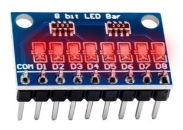
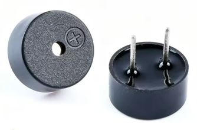

# A Toolkit for generating Square Waves on an ESP32
When working on electronics projects, it’s often helpful to have a pulse 
generator on hand. With an ESP32, you can easily program one yourself. 
It’s even possible to output multiple independent pulse sequences to 
different GPIO pins. 

In projects with the ESP32, I like to demonstrate correct operation using 
a `heartbeat`— that is, a flashing LED — or indicate a malfunction with 
the piercing beep of a buzzer. However, these functions should not delay 
the program’s execution by calling `delay()`. To achieve this — and 
because frequencies up to just over 10 kHz are sufficient for my 
purposes — I use a simple modulo operation on the micros() counter 
instead of delay() to ensure non-blocking execution in the main() loop.

The `PulseGen`, `Buzzer`, and `ThreePhaseGen` classes are grouped together 
in the `ToolkitSqareWaves` library within the `SqareWave` namespace.

The program shown here illustrates how to use this library to generate 
square waves on the GPIO pins. It demonstrates the use of heartbeat 
signals, buzzer tones, and even the generation of synchronized pulses 
with mutual phase shifts. An 8-bit LED bar and a passive piezo buzzer 
are connected to the GPIO pins to provide visual and audible feedback. 

|   LED Bar   |  Piezo Buzzer   |
|:-----------:|:---------------:|
|||

## Examples
👉 The constructors use polymorphism to enable different behaviors of the 
generators.

// "Heartbeat", defaults used: 1 beat/sec with 5% duty 
`SquareWave::PulseGen heartbeat(GPIO_NUM_16);`

// 3 beeps with 25% duty and a signal of 2kHz within 1 sec followed bei a pause of 2 sec  
`SquareWave::Buzzer buzzer(GPIO_NUM_2, 3, 25.0F, 1'000'000, 2'000'000, 2000);`

// Spike pulses on pin 4 with a frequency of 10 kHz and a pulse width of 5 µs  
`SquareWave::PulseGen spikes(GPIO_NUM_4, 100, 5);`

// 1 pulse in 5 sec with 5% duty 
`SquareWave::PulseGen gen1(GPIO_NUM_17, 1, 5, 5.0F);`

// 1 pulses in 5 sec with 5% duty an a phase shift of 120° 
`SquareWave::PulseGen gen2(GPIO_NUM_18, 1, 5, 5.0F, 120);`

// 1 pulses in 5 sec with 5% duty an a phase shift of 240° 
`SquareWave::PulseGen gen3(GPIO_NUM_19, 1, 5, 5.0F, 240);`

// Three-phase pulse trains on pins 17, 18, 19 with a 
// period of 2.5 sec, a duty of 5% and a phase shift of 108° 
`SquareWave::ThreephaseGen threephases(GPIO_NUM_17, GPIO_NUM_18, GPIO_NUM_19, 2'500'000, 5.0F, 108);`

The generators are started in `setup()` with, for example, 
`heartbeat.on();` 
`buzzer.on();` 
and called in the `main()` loop with 
`heartbeat.loop();` 
`buzzer.loop();`